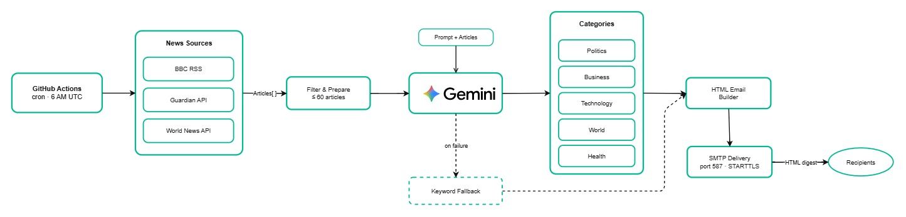

# Daily News Digest

Automated ETL pipeline that scrapes news from BBC, The Guardian, and World News API, summarizes it with Gemini 2.5 Flash Lite, and delivers a daily HTML digest email via SMTP. Runs at 6 AM UTC via GitHub Actions.

## Architecture



## Setup

### Local development

```bash
python -m venv .venv
.venv\Scripts\activate        # Windows
# source .venv/bin/activate   # macOS/Linux

pip install -r requirements.txt
cp .env.example .env          # fill in your keys
```

Run a dry run (no email sent):

```bash
DRY_RUN=true python main.py
```

### Environment variables

| Variable | Description |
|----------|-------------|
| `GEMINI_API_KEY` | Google AI Studio key |
| `GUARDIAN_API_KEY` | Guardian Content API key (free at open-platform.theguardian.com) |
| `WORLDNEWS_API_KEY` | World News API key (worldnewsapi.com) |
| `SMTP_HOST` | SMTP server hostname |
| `SMTP_PORT` | SMTP port (default `587`) |
| `SMTP_USER` | SMTP login username |
| `SMTP_PASSWORD` | SMTP login password |
| `SMTP_FROM` | From address (defaults to `SMTP_USER`) |
| `RECIPIENTS` | Comma-separated list of recipient email addresses |
| `ADMIN_EMAIL` | Error notification recipient |
| `DRY_RUN` | `true` to skip email send (local testing) |
| `ENABLE_LLM` | `true` to use Gemini (default), `false` to force fallback |
| `REQUEST_DELAY` | Seconds between scraper requests (default `2.5`) |

## Sources

| Source | Method |
|--------|--------|
| BBC | RSS feed + newspaper3k content extraction |
| The Guardian | Content API (`show-fields=bodyText`) |
| World News API | REST API (`/search-news`, `language=en`, `source-countries=us,gb`) |

All scrapers check `robots.txt`, enforce request delays, and skip articles older than 24 hours. Non-news categories (sport, culture, entertainment, etc.) are filtered out before summarization. Up to 60 articles per run, sorted newest-first.

## Summarization

Primary: **Gemini 2.5 Flash Lite** - receives the title + first 300 chars of each article, categorizes into Politics, Business, Technology, World, Health, or Other; groups by topic; writes one paragraph per group. Retries up to 3 times on transient API failures.

Fallback (on API failure): keyword scoring with word-boundary matching, first-two-sentence extraction. No external dependencies.

## Email delivery

Python connects directly to the SMTP server via STARTTLS on port 587. Recipients are configured via the `RECIPIENTS` environment variable (comma-separated). Each recipient receives an individual message.

## Tests

```bash
pytest tests/                        # full suite
pytest tests/test_scrapers.py -v     # scrapers only
pytest tests/integration/ -v         # integration only
pytest --cov=. --cov-report=html tests/  # with coverage
```
